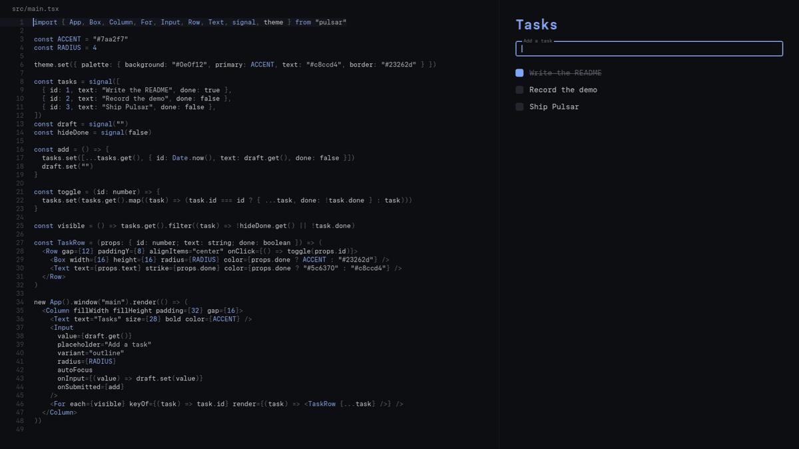

<p align="center">
  <strong>English</strong> ·
  <a href="docs/README.ru.md">Русский</a>
</p>

# Pulsar

Native apps in TypeScript for desktop and Android, without a browser engine. You write
the UI as functions or JSX, and Qt draws it on the GPU.



<sub>Scripted typing, with real files and a real `pulsar dev` reload. The code panel is a
small Pulsar app too: [`examples/tasks/demo`](examples/tasks/demo).</sub>

## Quick start

```sh
pulsar create my-app
cd my-app
pulsar dev
```

Save a file and the open window updates. See [Install](https://pulsarjs.org/install/)
for how to get the CLI.

```tsx
import { App, Button, Column, Text, signal } from "pulsar"

const count = signal(0)

new App().window("main").render(() => (
  <Column fillWidth fillHeight padding={24} gap={12}>
    <Text text={`Count: ${count.get()}`} size={20} />
    <Button label="+1" onClick={() => count.set(count.get() + 1)} />
  </Column>
))
```

## Why Pulsar

- **One codebase:** the same code runs on Linux, macOS, Windows and Android.
- **One file to ship:** `pulsar build` makes a single executable, and
  `pulsar build --target android` makes a signed APK.
- **Native rendering:** there is no Chromium, and animations, shaders, blur and glass
  are built in.
- **Your choice of runtime on the desktop:** Bun or QuickJS. Android uses QuickJS.

## Platforms

| Platform            | Self-contained | Status           |
| ------------------- | -------------- | ---------------- |
| Linux x64           | yes            | tested           |
| Linux ARM64         | yes            | built in CI      |
| macOS Apple Silicon | yes            | tested           |
| macOS Intel         | yes            | built in CI      |
| Windows x64         | yes            | tested           |
| Windows ARM64       | yes            | built in CI      |
| Android ARM64       | APK only       | tested on device |
| iOS Simulator       | from source    | experimental     |

## Documentation

Everything else is on **[pulsarjs.org](https://pulsarjs.org)**:

- [Build an app](https://pulsarjs.org/guide/), a complete task app from an empty project
- [Coming from the web](https://pulsarjs.org/guide/web/), for CSS and React developers
- [CLI](https://pulsarjs.org/cli/) and [manifest](https://pulsarjs.org/manifest/)
- [Building from source](https://pulsarjs.org/building/)

The same reference is in [`docs/reference.md`](docs/reference.md), and the history is in
[`CHANGELOG.md`](CHANGELOG.md).

## License

MIT, see [`LICENSE`](LICENSE). Pulsar links Qt (LGPL-3.0) dynamically, see
[`THIRD_PARTY_NOTICES.md`](THIRD_PARTY_NOTICES.md).
