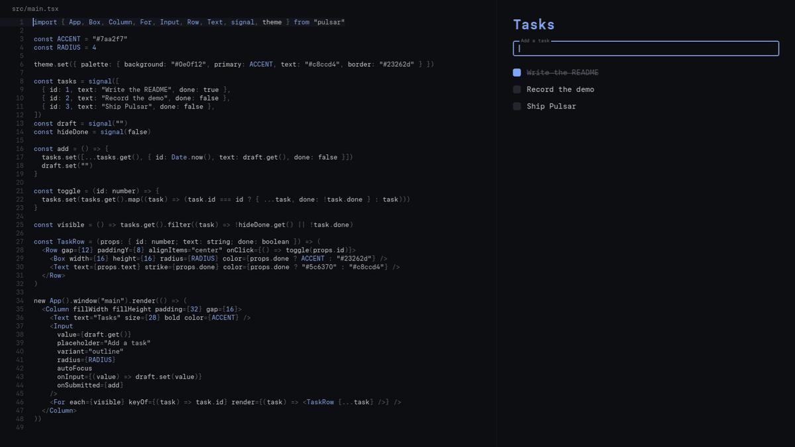

<p align="center">
  <a href="../README.md">English</a> ·
  <strong>Русский</strong>
</p>

# Pulsar

Нативные приложения на TypeScript для компьютера и Android без браузерного движка.
Интерфейс пишется функциями или JSX, а рисует его Qt на GPU.



<sub>Ввод идёт по сценарию, но файлы и перезагрузка через `pulsar dev` настоящие. Панель
кода — тоже небольшое приложение на Pulsar: [`examples/tasks/demo`](../examples/tasks/demo).</sub>

## Быстрый старт

```sh
pulsar create my-app
cd my-app
pulsar dev
```

Сохраните файл, и открытое окно обновится. Как получить CLI, описано в разделе
[Установка](https://pulsarjs.org/ru/install/).

```tsx
import { App, Button, Column, Text, signal } from "pulsar"

const count = signal(0)

new App().window("main").render(() => (
  <Column fillWidth fillHeight padding={24} gap={12}>
    <Text text={`Count: ${count.get()}`} size={20} />
    <Button label="+1" onClick={() => count.set(count.get() + 1)} />
  </Column>
))
```

## Зачем Pulsar

- **Один код:** он работает на Linux, macOS, Windows и Android.
- **Один файл для поставки:** `pulsar build` создаёт один исполняемый файл, а
  `pulsar build --target android` — подписанный APK.
- **Нативная отрисовка:** Chromium нет, а анимации, шейдеры, размытие и стекло уже
  встроены.
- **Выбор среды на компьютере:** Bun или QuickJS. На Android работает QuickJS.

## Платформы

| Платформа           | Самодостаточно | Статус                  |
| ------------------- | -------------- | ----------------------- |
| Linux x64           | да             | проверено               |
| Linux ARM64         | да             | собрано в CI            |
| macOS Apple Silicon | да             | проверено               |
| macOS Intel         | да             | собрано в CI            |
| Windows x64         | да             | проверено               |
| Windows ARM64       | да             | собрано в CI            |
| Android ARM64       | только APK     | проверено на устройстве |
| iOS Simulator       | из исходников  | экспериментально        |

## Документация

Всё остальное на **[pulsarjs.org](https://pulsarjs.org/ru/)**:

- [Соберите приложение](https://pulsarjs.org/ru/guide/): полное приложение задач с нуля
- [Если вы пришли из веба](https://pulsarjs.org/ru/guide/web/): для тех, кто знает CSS и React
- [CLI](https://pulsarjs.org/ru/cli/) и [манифест](https://pulsarjs.org/ru/manifest/)
- [Сборка из исходников](https://pulsarjs.org/ru/building/)

Тот же справочник лежит в [`reference.ru.md`](reference.ru.md), а история изменений — в
[`CHANGELOG.md`](../CHANGELOG.md).

## Лицензия

MIT, см. [`LICENSE`](../LICENSE). Pulsar динамически линкует Qt (LGPL-3.0), см.
[`THIRD_PARTY_NOTICES.md`](../THIRD_PARTY_NOTICES.md).
